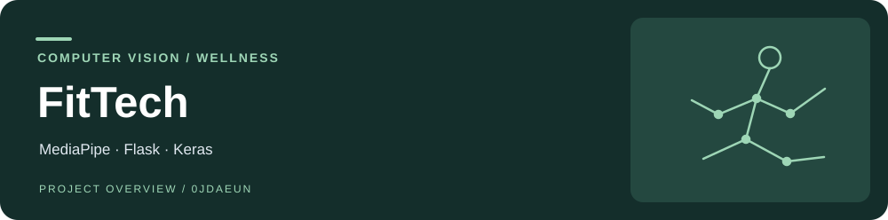
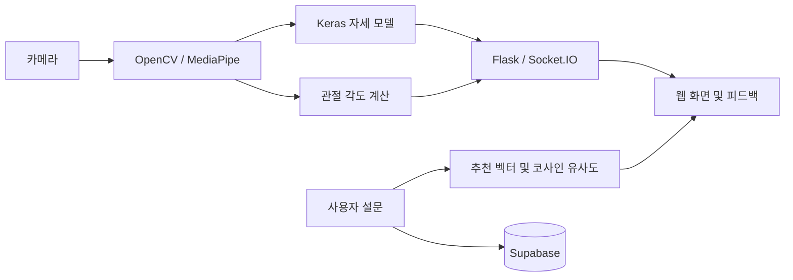

# FitTech

**실시간 요가 자세 인식·교정과 사용자 맞춤 운동 추천**

2024 팀 프로젝트 · Flask · OpenCV · MediaPipe · TensorFlow/Keras · Supabase

[영상 처리 코드](flask/app.py) · [추천 알고리즘](flask/recommend.py) · [설문 처리](flask/views/survey_views.py)

## 01. 프로젝트 배경

혼자 운동할 때 자신의 자세가 올바른지 판단하기 어렵고, 자신에게 맞는 운동을 선택하는 과정에도 정보가 필요하다. FitTech는 카메라 기반 자세 인식과 교정 피드백, 설문 응답 기반 추천을 하나의 웹 서비스로 연결한다.

## 02. 주요 기능

| 기능 | 구현 방식 |
| --- | --- |
| 자세 인식 | OpenCV 카메라 입력, MediaPipe 특징 추출, Keras 모델 추론 |
| 자세 교정 | 관절 각도 계산과 교정 피드백 |
| 실시간 상태 전달 | Flask-SocketIO를 통한 시간·자세·피드백 전달 |
| 맞춤 추천 | 설문 기반 사용자 벡터와 운동 벡터의 코사인 유사도 비교 |
| 운동 관리 | 로그인, 설문, 캘린더 및 운동 관련 화면 |

## 03. 시스템 아키텍처



## 04. 핵심 구현

### 실시간 영상 분석

[flask/app.py](flask/app.py)에서 카메라 입력, 랜드마크 처리, 자세 모델 로딩, 각도 기반 피드백 및 Socket.IO 이벤트를 확인할 수 있다. 영상 추론과 사용자에게 보여주는 교정 상태를 연결한다.

### 사용자 맞춤 추천

[flask/recommend.py](flask/recommend.py)는 사용자 프로필과 추천 대상 벡터를 구성하고 코사인 유사도를 이용해 후보를 비교한다. 이 값은 벡터 간 유사도를 나타내며 운동의 임상적 효과나 적합성을 검증하는 지표는 아니다.

### 데이터 관리

[flask/views/survey_views.py](flask/views/survey_views.py)는 사용자 설문을 처리하고 응답을 Supabase에 저장한다. 사용자 입력을 추천 과정에서 활용할 수 있는 데이터로 구조화한다.

## 05. 개인 기여

팀 전체의 영상 인식 및 추천 기능과 별도로, 개인 계정의 커밋에서 확인 가능한 기여는 다음과 같다.

| 작업 | 근거 |
| --- | --- |
| 설문 응답 JSON 구조화 | [commit](https://github.com/0JDaEun/fittech/commit/515d2760d8f9d09677b7cc37b40d08a10c9397c6) |
| Supabase 데이터 저장 | [commit](https://github.com/0JDaEun/fittech/commit/519cc6277ace7afb3d2e62fb941cecf6da5b58b7) |
| 회원가입 필드명 오류 수정 | [commit](https://github.com/0JDaEun/fittech/commit/b3130293c527d6a111d0860e8d9ea61f05ef41ac) |

## 06. 코드 구조

```text
flask/
  app.py           Flask·Socket.IO 및 영상 처리
  db_config.py     데이터베이스 연결 설정
  recommend.py     추천 알고리즘
  model/           저장된 자세 모델
  views/           로그인·설문·캘린더 등
  templates/       웹 화면
  static/          JavaScript·CSS·이미지·영상
requirements.txt   초기 Python 의존성 목록
```

> **유지보수 상태 (2026-11-26)**: 2024년 팀 프로젝트 원본을 보존하고 있다. 별도 보안 검토 브랜치에서 DB·Flask 설정 분리와 Python 캐시 정리를 진행했으며 [오프라인 CI 4개 테스트 및 문법 검사](https://github.com/0JDaEun/fittech/actions/runs/45730910777)가 통과했다. 모델 로딩, 실제 DB 및 카메라 연동은 미검증 상태다. [설정 가이드](https://github.com/0JDaEun/fittech/blob/security/config-hardening/docs/SECURITY_SETUP.md) · [검증 범위](https://github.com/0JDaEun/fittech/blob/security/config-hardening/docs/SECURITY_VALIDATION.md)

## 07. 실행 환경과 재현성

카메라, Python 및 TensorFlow와 호환되는 환경, Supabase 설정이 필요하다. 모델 파일은 [flask/model](flask/model)에 있으며, 메인 코드의 상대 경로를 고려하면 실행 진입점은 다음과 같다.

```bash
cd flask
python app.py
```

단, 기존 requirements.txt에는 오래된 TensorFlow 버전과 재정리가 필요한 패키지 항목이 있다. 호환 버전을 확정하고 하드코딩된 연결 설정을 안전하게 분리한 뒤 실행해야 한다. 현재 문서 작성 단계에서 신규 설치·실시간 카메라 추론은 검증하지 않았다.

## 08. 한계 및 개선 방향

- 모델 학습 데이터와 테스트셋 기준의 정확도·오류 사례 정리
- 조명, 시점, 가림에 따른 인식 한계 검증
- 영상 추론·추천·웹 라우팅 코드 분리 및 테스트 추가
- 실행 환경 재현성 및 비밀 설정 관리 개선
- 실제 자세 교정 및 추천 화면 캡처 확보

이 프로젝트는 운동 보조 프로토타입이며 의료적 진단이나 안전한 운동 수행을 보장하지 않는다.
